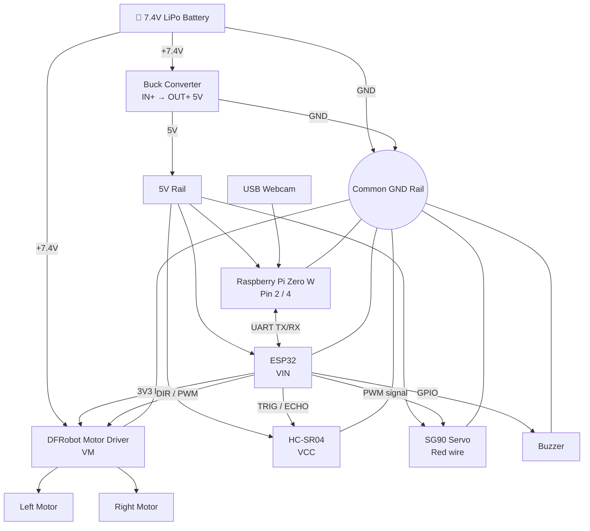

# 🔌 Delivery Bot — Wiring Guide

Complete wiring reference for the delivery bot: a **Raspberry Pi Zero W** (vision / high-level control) talking over UART to an **ESP32** (motor, sensor and actuator control), powered from a **7.4V LiPo** through a **5V buck converter**.


---

## 📑 Table of Contents

1. [Bill of Materials](#-bill-of-materials)
2. [System Architecture](#-system-architecture)
3. [Power Distribution](#1-power-distribution)
4. [Raspberry Pi Zero W](#2-raspberry-pi-zero-w)
5. [ESP32](#3-esp32)
6. [Pin Map Summary](#-esp32-pin-map-summary)
7. [Pre-Power-On Checklist](#-pre-power-on-checklist)
8. [Design Notes & Recommendations](#-design-notes--recommendations)

---

## 🧰 Bill of Materials

| Component | Qty | Role |
| --- | :---: | --- |
| 7.4V LiPo battery (2S) | 1 | Main power source |
| 5V buck converter | 1 | Regulates 7.4V → 5V for logic and servo |
| Raspberry Pi Zero W | 1 | Camera processing, high-level commands |
| ESP32 dev board | 1 | Real-time motor and sensor control |
| DFRobot dual motor driver | 1 | Drives the two DC motors |
| Yellow BO motors | 2 | Left / right wheels |
| HC-SR04 ultrasonic sensor | 1 | Obstacle detection |
| SG90 micro servo | 1 | Delivery compartment / lid actuator |
| Buzzer | 1 | Audible alarm |
| USB webcam + Micro-USB OTG adapter | 1 | Vision input for the Pi |
| Breadboard + jumper wires | — | Power rails and connections |

---

## 🗺 System Architecture



### Power domains

| Domain | Voltage | Feeds |
| --- | :---: | --- |
| Raw battery | **7.4V** | Buck converter `IN+`, motor driver `VM` — **nothing else** |
| Regulated rail | **5V** | Pi Zero, ESP32 `VIN`, HC-SR04, SG90 |
| Logic | **3.3V** | ESP32 `3V3` → motor driver `VCC` |

> [!IMPORTANT]
> **Common ground:** every `-` / `GND` line must tie into the same ground network on the breadboard.

---

## 1. Power Distribution

| Source | Terminal | Destination | Function |
| --- | --- | --- | --- |
| LiPo Battery (7.4V) | Red `+` | Buck `IN+` **and** Driver `VM(<12V)` | Raw high-power input |
| LiPo Battery (7.4V) | Black `-` | Buck `IN-` **and** Breadboard GND rail | Main system ground |
| 5V Buck Converter | `OUT+` (5V) | Breadboard 5V rail | Regulated logic / servo supply |
| 5V Buck Converter | `OUT-` (GND) | Breadboard GND rail | Common ground reference |

---

## 2. Raspberry Pi Zero W

Powered from the regulated 5V rail through the GPIO header. Talks to the ESP32 over UART and to the webcam over USB.

| Interface | Pin Label | Physical Pin | Connect To | Notes |
| --- | --- | :---: | --- | --- |
| Power | `5V` | **2** or **4** | Breadboard 5V rail | Powered from buck converter |
| Ground | `GND` | **6** | Breadboard GND rail | Shared ground |
| UART TX | `GPIO 14 (TXD)` | **8** | ESP32 `RX2` (GPIO 16) | Commands: Pi → ESP32 |
| UART RX | `GPIO 15 (RXD)` | **10** | ESP32 `TX2` (GPIO 17) | Telemetry / ACK: ESP32 → Pi |
| USB data port | Micro-USB (inner, `USB`) | — | USB webcam | Use Micro-USB → USB-A OTG adapter |
| USB power port | Micro-USB (`PWR IN`) | — | *Leave empty* | Power comes via GPIO pins |

---

## 3. ESP32

### 3.1 Power & Serial

| ESP32 Pin | Connect To | Notes |
| --- | --- | --- |
| `VIN` | Breadboard 5V rail | Onboard regulator steps down to 3.3V |
| `GND` | Breadboard GND rail | Shared ground |
| `3V3` | Motor driver `VCC` | 3.3V logic supply for the driver |
| `RX2` (GPIO 16) | Pi Pin 8 (GPIO 14 TXD) | Crossed: Pi TX → ESP RX |
| `TX2` (GPIO 17) | Pi Pin 10 (GPIO 15 RXD) | Crossed: ESP TX → Pi RX |

### 3.2 DFRobot Motor Driver

| Driver Pin | Connect To | Function |
| --- | --- | --- |
| `VCC` (bottom-left) | ESP32 `3V3` | Logic supply |
| `GND` (left) | Breadboard GND rail | Logic ground |
| `DIR1` | ESP32 `D25` | Left motor direction |
| `PWM1` | ESP32 `D26` | Left motor speed / enable |
| `PWM2` | ESP32 `D27` | Right motor speed / enable |
| `DIR2` | ESP32 `D14` | Right motor direction |
| `VM(<12V)` (bottom-right) | Battery red wire (+7.4V) | Motor power, direct from battery |
| `GND` (right) | Breadboard GND rail | Motor power ground |
| `M1+` / `M1-` | Left yellow BO motor | Left wheel |
| `M2+` / `M2-` | Right yellow BO motor | Right wheel |

> [!NOTE]
> **Motor polarity:** the two yellow DC motors are mounted on opposite sides of the chassis, facing away from each other, so connecting them identically may make one wheel spin backward. If the robot spins in place when commanded forward (`F`), swap the two wires on `M2+` and `M2-`.

### 3.3 Ultrasonic Sensor (HC-SR04)

| HC-SR04 Pin | Connect To | Notes |
| --- | --- | --- |
| `VCC` | Breadboard 5V rail | Needs 5V for reliable pings |
| `TRIG` | ESP32 `D5` | Trigger pulse output |
| `ECHO` | ESP32 `D18` | Echo input. A direct connection is acceptable for short prototyping tests, but a 1kΩ / 2kΩ resistor divider to step the 5V echo pulse down to 3.3V is recommended for long-term safety — **see [level-shifting note](#-design-notes--recommendations)** |
| `GND` | Breadboard GND rail | Ground |

### 3.4 Servo (SG90) & Buzzer

| Component Pin | Connect To | Notes |
| --- | --- | --- |
| Servo red | Breadboard 5V rail | High current — powered directly from the 5V rail |
| Servo brown | Breadboard GND rail | Ground |
| Servo yellow/orange | ESP32 `D13` | PWM position signal |
| Buzzer long leg (`+`) | ESP32 `D19` | Driven HIGH to sound the alarm |
| Buzzer short leg (`-`) | Breadboard GND rail | Ground |

---

## 📍 ESP32 Pin Map Summary

| GPIO | Label | Connected To | Direction |
| :---: | :---: | --- | :---: |
| 5 | D5 | HC-SR04 `TRIG` | Out |
| 13 | D13 | Servo signal | Out (PWM) |
| 14 | D14 | Driver `DIR2` (right motor) | Out |
| 16 | RX2 | Pi TXD (Pin 8) | In |
| 17 | TX2 | Pi RXD (Pin 10) | Out |
| 18 | D18 | HC-SR04 `ECHO` | In |
| 19 | D19 | Buzzer `+` | Out |
| 25 | D25 | Driver `DIR1` (left motor) | Out |
| 26 | D26 | Driver `PWM1` (left motor) | Out (PWM) |
| 27 | D27 | Driver `PWM2` (right motor) | Out (PWM) |

---

## ✅ Pre-Power-On Checklist

- [ ] **Verify buck output.** Connect *only* the battery to the converter and confirm `OUT+` reads **5.0V – 5.2V** with a multimeter *before* attaching the Pi or ESP32.
- [ ] **Check polarity.** 7.4V must reach **only** the buck `IN+` and driver `VM`. Applying it to ESP32 `VIN`/`3V3` or the Pi will permanently damage them.
- [ ] **Check common ground.** Battery, buck, Pi, ESP32, driver, sensor, servo and buzzer all share one GND rail.
- [ ] **USB camera.** Plug into the **inner** Micro-USB port (`USB`), not the outer one (`PWR IN`).
- [ ] **UART crossover.** Pi TX → ESP RX and Pi RX → ESP TX (not straight-through).

> [!WARNING]
> Double-check every connection with the battery **disconnected**, then connect power last.

---

## 💡 Design Notes & Recommendations

> [!CAUTION]
> **HC-SR04 `ECHO` is a 5V signal and the ESP32 GPIOs are 3.3V-only.** A direct wire to `D18` is acceptable for short prototyping tests if resistors aren't on hand, but it is out of spec and can damage the pin over time. For anything long-term, add a voltage divider on the echo line:
>
> ```
> ECHO ──[ 1kΩ ]──┬── ESP32 D18
>                 │
>               [ 2kΩ ]
>                 │
>                GND
> ```
> (A 1kΩ + 2kΩ divider gives ≈ 3.3V. Using 2 × 1kΩ in series for the lower leg also works.)

**Other things worth considering**

- **Buck converter current rating:** the 5V rail feeds the Pi Zero W (+ webcam), ESP32, sonar and servo. An SG90 can spike to ~650 mA when stalled, so use a converter rated **≥ 2A**.
- **Brown-out protection:** servo spikes can reset the Pi. Add a **470–1000 µF** electrolytic capacitor across the 5V rail near the servo (and optionally a 100 nF ceramic).
- **Raspberry Pi UART (Pi Zero W):** `raspi-config` alone is often not enough. Onboard Bluetooth claims the primary hardware UART (`ttyAMA0`), leaving GPIO 14/15 on the unstable mini-UART (`ttyS0`). Do both steps below, then reboot.

  1. Run `sudo raspi-config` → *Interface Options* → *Serial Port*: login console **No**, serial hardware **Yes**.
  2. Add the following to the bottom of `/boot/firmware/config.txt` (or `/boot/config.txt` on older OS images):

     ```ini
     enable_uart=1
     dtoverlay=disable-bt
     ```

  This disables onboard Bluetooth and routes the stable hardware UART to GPIO 14 & 15. Use **115200 baud** on both the Pi and the ESP32. If you need Bluetooth, use `dtoverlay=miniuart-bt` instead, but then set `core_freq=250` in the same file so the UART stays stable.
- **Buzzer type:** an *active* buzzer can be driven directly from a GPIO pin; a larger or passive buzzer should go through a transistor.
- **Boot-strapping pins:** `GPIO 5` and `GPIO 14` are sampled / toggled at ESP32 boot. This normally works fine, but if the bot twitches on reset, consider moving those signals.

---

## 📄 License

This project is licensed under the [MIT License](LICENSE).